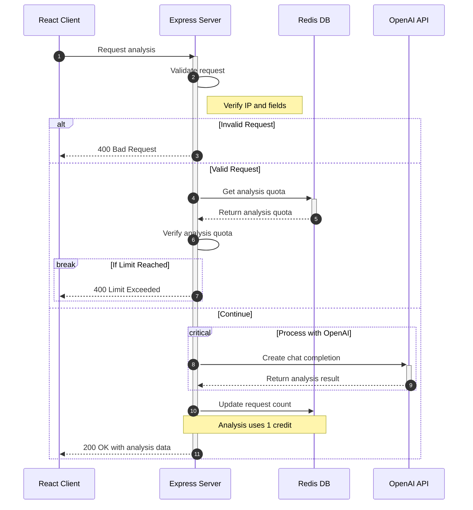

# English Syntax Analyzer and Editor

[한국어](README.md) · [English](README.en.md) · [简体中文](README.zh-Hans.md) · [日本語](README.ja.md)


Syntax Analyzer is a web app that automatically analyzes English sentence structure and lets you edit the results. It uses more than 30 common grammar tags to show how complex sentences fit together. It can also generate random sentences on the topics you enter. Syntax analysis uses GPT-6 Luna.

- Web app · [https://syntax-analyzer.romantech.net](https://syntax-analyzer.romantech.net/)
- [Express API reference](apps/api/README.md)
- Fine-tuning repository · [https://github.com/romantech/openai-fine-tuning](https://github.com/romantech/openai-fine-tuning)

# Contents

- [Features](#features)
- [Tech Stack](#tech-stack)
  - [Frontend](#frontend)
  - [Backend](#backend)
- [How Analysis Data Is Generated](#how-analysis-data-is-generated)
- [How the Parser Works](#how-the-parser-works)
- [Tagging Rules](#tagging-rules)
- [Sentence Constituents](#sentence-constituents)
- [Screenshots](#screenshots)

# Features

> [!NOTE]
> Before analysis, the app expands contractions such as `I'll` to `I will`. It keeps ambiguous `'s` endings as written.\
> It also removes all commas from numbers, so `6,500` becomes `6500`.

1. Analyze English sentences to identify subjects, verbs, objects, phrases, clauses, and other constituents.
2. Edit English syntax and visualize sentence structure with more than 30 grammar tags.
3. Generate random English sentences on the topics you enter.

If the app reports that it could not load the page after a new deployment, select **Reload** to open the current page again.

# Tech Stack

### Frontend

- **Framework** · React with TypeScript
- **UI Library** · Chakra UI
- **CSS Preprocessor** · SCSS
- **State Management** · Jotai / React Query
- **Form Handling** · React Hook Form / Yup
- **Animation** · Framer Motion / Lottie

### Backend

- **Framework** · Express with TypeScript
- **Database and Cache** · Redis (using ioredis)
- **Syntax Analysis** · OpenAI / LangChain

# How Analysis Data Is Generated



# How the Parser Works

The parser starts by tokenizing the input sentence. It puts the tokens in a root segment and organizes segments as a graph. Each segment records its start and end token indices. To add a constituent, the parser searches for segments that cover its token range and creates or combines segments as needed.

1. If the range matches the current segment, add the constituent to that segment.
2. If the range is shorter than the current segment, look for a child segment that contains it.
3. If no child segment contains the range, combine child segments to create a new segment.
4. If there are no child segments, create a new segment.

The diagram below shows how the segments for `Global warming is a significant issue` change as constituents are added at token ranges `3-6`, `5-6`, and `4-6`.


# Tagging Rules

AI analyses initially show the main parts of the sentence, such as the subject, verb, object, and complement, along with modifiers at that level, such as adverbs, adverbial phrases, and prepositional phrases. Select a tag to see its details. Use **Expand all tags** to see every tag and **Collapse all tags** to return to the overview. All tags are visible while adding or deleting a tag. Tags use full names in the current language by default. Turn on **Abbreviations** to show shortened names. Your choice is saved across reloads.

On mobile, tap **Choose a tag** in the bottom toolbar. Tap the first word, then tap **Apply** to tag just that word. To tag a range, tap the first and last words before applying the tag. Tap **Clear selection** to clear the range. For long sentences, swipe horizontally on the sentence or the blank space below the tags. When the stack of tags is taller than the screen, swipe vertically in the same area. When the content overflows, the vertical scrollbar appears to the right of the tag area and the horizontal scrollbar appears below it. In delete mode, tap the tag you want to remove.

Your tags are saved to the sentence you started editing even if another tab changes the order of the list. If that sentence was deleted, the editor tells you that it cannot save your changes.

Tagging identifies the grammatical role of a word, phrase, or clause. Tags are applied to whole words, and phrase or clause ranges cannot cross. A crossing range would require breaking apart and rebuilding existing segments.

For example, when `Global warming is a significant issue` already has the `S`, `V`, and `C` tags shown below, you cannot tag `warming is` or `is a significant`. You can tag a range such as `Global warming is` that fully contains both constituents.

```
[Global warming] [is] [a significant issue]
---------------- ---- ---------------------
       S          V             C

Allowed: Global warming is / is a significant issue
Disallowed: warming is / is a / is a significant
```

# Sentence Constituents

The analyzer uses the grammatical categories below, and the editor uses them as tags. Turn on **Tag descriptions** to see what each grammatical category means in the tag picker. A single word is a token. Groups of two or more words are classified as phrases or clauses according to their grammatical structure.

| Label                | Abbreviation | Type   | Description                                                                       |
| -------------------- | ------------ | ------ | --------------------------------------------------------------------------------- |
| Subject              | s            | token  | A word or phrase that tells who or what the sentence is about                     |
| Verb                 | v            | token  | A word that expresses an action or a state in a sentence                          |
| Modal verb           | mod          | token  | A verb used with another verb to add meaning                                      |
| Object               | o            | token  | A word or phrase affected by the action or state expressed by the verb            |
| Indirect object      | i.o.         | token  | A word or phrase that indicates the recipient or beneficiary of an action         |
| Direct object        | d.o.         | token  | A word or phrase directly affected by the action of a verb                        |
| Prepositional object | prp.o.       | token  | A word or phrase introduced by a preposition                                      |
| Complement           | c            | token  | A word or phrase that describes or completes the meaning of the subject or object |
| Object complement    | o.c.         | token  | A word or phrase that describes or completes the meaning of the object            |
| To-infinitive        | to-inf       | token  | The base form of a verb used with to                                              |
| Gerund               | g            | token  | The -ing form of a verb used as a noun                                            |
| Participle           | pt           | token  | The present or past participle form of a verb                                     |
| Conjunction          | conj         | token  | A word that connects grammatical elements                                         |
| Adverb               | adv          | token  | A word that modifies a verb, adjective, or adverb                                 |
| Participle phrase    | pt.phr       | phrase | A phrase made up of a participle and its related elements                         |
| Prepositional phrase | prp.phr      | phrase | A phrase consisting of a preposition and its object                               |
| Noun phrase          | n.phr        | phrase | A phrase consisting of a noun and its modifiers                                   |
| Adverbial phrase     | adv.phr      | phrase | A phrase that functions as an adverb in a sentence                                |
| Verb phrase          | v.phr        | phrase | A phrase that functions as a verb in a sentence                                   |
| Adjectival phrase    | adj.phr      | phrase | A phrase that functions as an adjective in a sentence                             |
| Gerund phrase        | g.phr        | phrase | A phrase consisting of a gerund and related words                                 |
| Infinitive phrase    | inf.phr      | phrase | A phrase consisting of to, the base form of a verb, and related elements          |
| Coordinating clause  | co.cl        | clause | One of two or more clauses of equal grammatical status                            |
| Parallel clause      | p.cl         | clause | One of two or more clauses with the same grammatical structure                    |
| Noun clause          | n.cl         | clause | A clause that functions as a noun in a sentence                                   |
| Adjectival clause    | adj.cl       | clause | A clause that functions as an adjective in a sentence                             |
| Adverbial clause     | adv.cl       | clause | A clause that functions as an adverb in a sentence                                |
| Inserted clause      | i.cl         | clause | A clause inserted into another clause                                             |
| Relative clause      | rel.cl       | clause | A clause that adds information about an element in the main clause                |
| Dependent clause     | dep.cl       | clause | A clause that depends on another clause to form a complete sentence               |
| Independent clause   | ind.cl       | clause | A clause that expresses a complete thought on its own                             |

# Screenshots

#### Home


#### English Syntax Analysis Form


#### English Syntax Editor


#### Random Sentence Generator


