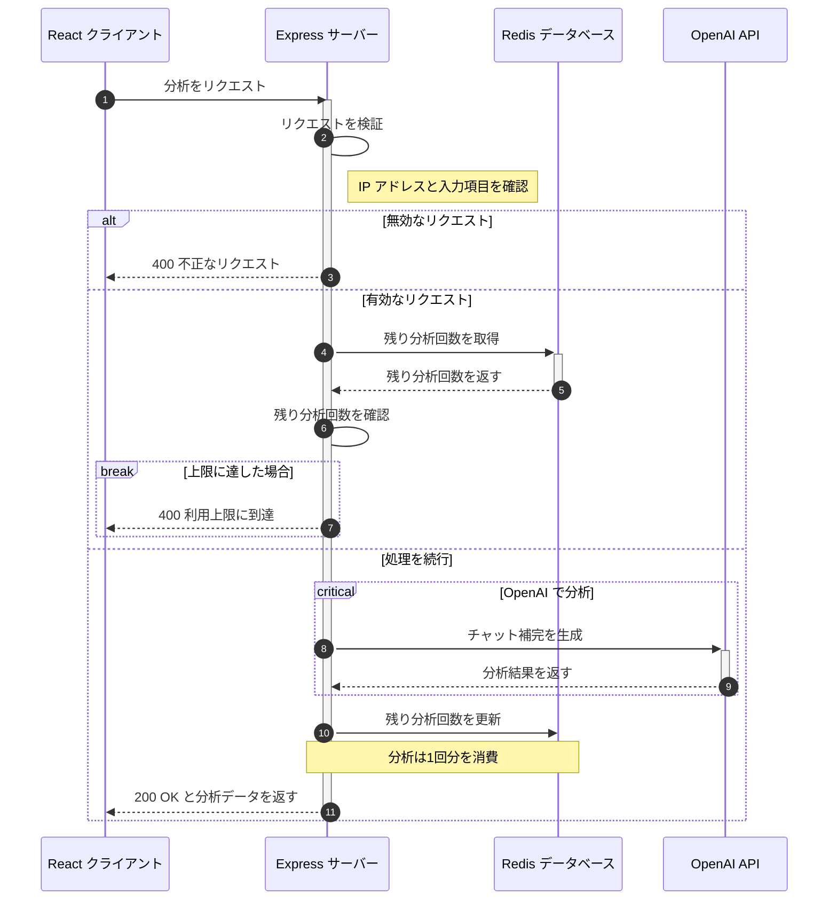

# 英語構文アナライザーとエディター

[한국어](README.md) · [English](README.en.md) · [简体中文](README.zh-Hans.md) · [日本語](README.ja.md)


Syntax Analyzer は、英文の構造を自動で分析し、その結果を自由に編集できるウェブアプリです。よく使われる30種類以上の文法タグで、複雑な英文の構造をひと目で確認できます。入力したトピックに沿って英文をランダムに生成することもできます。英文分析には GPT-6 Luna を使用しています。

- ウェブアプリ · [https://syntax-analyzer.romantech.net](https://syntax-analyzer.romantech.net/)
- [Express API リファレンス](apps/api/README.md)
- ファインチューニングのリポジトリ · [https://github.com/romantech/openai-fine-tuning](https://github.com/romantech/openai-fine-tuning)

# 目次

- [主な機能](#主な機能)
- [技術スタック](#技術スタック)
  - [フロントエンド](#フロントエンド)
  - [バックエンド](#バックエンド)
- [分析データの生成フロー](#分析データの生成フロー)
- [構文解析の仕組み](#構文解析の仕組み)
- [タグ付けの制約](#タグ付けの制約)
- [文の構成要素](#文の構成要素)
- [スクリーンショット](#スクリーンショット)

# 主な機能

> [!NOTE]
> 分析前に `I'll` などの短縮形を展開します（`I'll` → `I will`）。所有格にも短縮形にもなる `'s` は入力のまま分析します。\
> 数値に含まれるカンマはすべて取り除きます（`6,500` → `6500`）。

1. 英文を分析し、主語・動詞・目的語・句・節などの構成要素を特定します。
2. 30種類以上の文法タグで英文の構造を可視化し、分析結果を編集できます。
3. 入力したトピックに沿って英文をランダムに生成できます。

新しいバージョンのデプロイ後にページを読み込めないというメッセージが表示されたら、**再読み込み**を押して現在のページを開き直します。

# 技術スタック

### フロントエンド

- **フレームワーク** · React + TypeScript
- **UI ライブラリ** · Chakra UI
- **CSS プリプロセッサー** · SCSS
- **状態管理** · Jotai / React Query
- **フォーム管理** · React Hook Form / Yup
- **アニメーション** · Framer Motion / Lottie

### バックエンド

- **フレームワーク** · Express + TypeScript
- **データベースとキャッシュ** · Redis（ioredis を使用）
- **構文分析** · OpenAI / LangChain

# 分析データの生成フロー



# 構文解析の仕組み

まず、入力された英文をトークン化し、最小単位に分割します。トークンはルート（最上位）のセグメントに入れ、セグメントをグラフ構造で管理します。各セグメントは開始位置と終了位置のトークンインデックスを保持します。文の構成要素を追加するときは、該当するトークン範囲を対象にセグメントを探し、必要に応じて新しいセグメントを作成したり、既存のセグメントを結合したりします。

1. 範囲が現在のセグメントと一致する場合は、そのセグメントに構成要素を追加します。
2. 範囲が現在のセグメントより狭い場合は、その範囲を含む子セグメントを探します。
3. 範囲を含む子セグメントがない場合は、子セグメントを結合して新しいセグメントを作成します。
4. 子セグメントが一つもない場合は、新しいセグメントを作成します。

下の図は、`Global warming is a significant issue` のトークン範囲 `3-6`、`5-6`、`4-6` に構成要素を順に追加すると、セグメントがどう変わるかを示しています。


# タグ付けの制約

AI分析の基本表示では、主語・動詞・目的語・補語・副詞的修飾語など、文の中での役割を表示します。動詞が必要とする場所は場所補語として表示します。詳細を開くと、副詞や前置詞句などの形と、完了・進行・受動・do の助動詞を確認できます。 **すべてのタグを展開**ですべて表示し、**すべてのタグを折りたたむ**で最初の表示に戻ります。タグの追加や削除中は、すべてのタグが表示されます。タグは既定で現在の言語の正式名称が表示されます。**略称**をオンにすると略称が表示され、再読み込み後も選択が保持されます。

モバイルでは、下部のツールバーで **タグを選択** をタップします。開始単語をタップして **適用** を押すと、その単語にタグが付きます。範囲にタグを付けるには、開始単語と終了単語をタップしてから適用します。**選択を解除** で範囲の選択を取り消せます。英文が長い場合は、英文またはタグの下の余白を左右にスワイプできます。積み重なったタグが画面の高さを超える場合は、同じ領域で上下にスワイプできます。内容が収まらないときは、縦スクロールバーがタグ領域の右側、横スクロールバーが下側に表示されます。削除モードでは、削除するタグをタップします。

別のタブでリストの順序が変わっても、タグは編集を始めた英文に保存されます。その英文が削除されている場合は、保存できないというメッセージが表示されます。

タグ付けでは、単語や句・節の文法上の役割を示します。タグは単語単位で付け、句や節の範囲は交差できません。既存の範囲と交差するタグを付けると、構築済みのセグメントを分解して組み直す必要があるためです。

たとえば、`Global warming is a significant issue` に下のように `S`、`V`、`C` のタグが付いている場合、`warming is` や `is a significant` にはタグを付けられません。`Global warming is` のように、二つの構成要素を丸ごと含む範囲にはタグを付けられます。

```
[Global warming] [is] [a significant issue]
---------------- ---- ---------------------
       S          V             C

許可: Global warming is / is a significant issue
禁止: warming is / is a / is a significant
```

# 文の構成要素

説明と一覧は[文の構成要素](docs/syntax-tags.ja.md)ドキュメントを参照してください。

# スクリーンショット

#### ホーム画面


#### 英文の構文分析フォーム


#### 英文の構文エディター


#### ランダム英文生成


