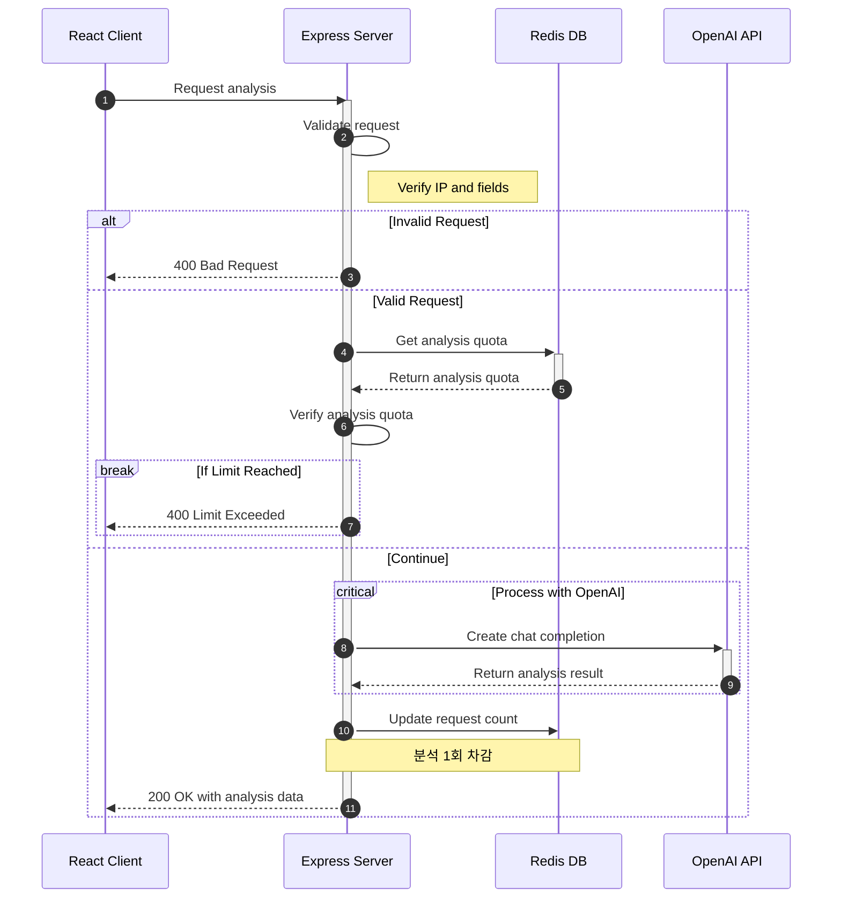

# 영어 구문 분석 / 편집기

[한국어](README.md) · [English](README.en.md) · [简体中文](README.zh-Hans.md) · [日本語](README.ja.md)


Syntax Analyzer는 영어 문장의 다양한 구문을 자동으로 분석해 주고, 원하는 형태로 구문을 편집할 수 있는 웹 어플리케이션입니다. 자주 사용하는 30여 가지의 문법 태그를 통해 복잡한 문장 구조를 한눈에 파악할 수 있도록 도와줍니다. 입력한 주제와 연관된 랜덤 문장 생성 기능도 제공합니다. 구문 분석에는 GPT-6 Luna를 사용합니다.

- 어플리케이션 링크: [https://syntax-analyzer.romantech.net](https://syntax-analyzer.romantech.net/)
- [Express API 명세](apps/api/README.md) · [로컬 개발 및 API 변경 가이드](docs/api-integration.md)
- 파인튜닝 레포지토리: [https://github.com/romantech/openai-fine-tuning](https://github.com/romantech/openai-fine-tuning)

# 목차

- [주요 기능](#주요-기능)
- [사용 스택](#사용-스택)
  - [Frontend](#frontend)
  - [Backend](#backend)
- [분석 데이터 생성 흐름](#분석-데이터-생성-흐름)
- [구문 분석기 동작 방식](#구문-분석기-동작-방식)
- [태깅 제약 조건](#태깅-제약-조건)
- [문장 성분 목록](#문장-성분-목록)
- [스크린샷](#스크린샷)

# 주요 기능

> [!NOTE]  
> `I'll`은 `I will`로 풀어서 분석합니다. 소유격이나 축약형이 될 수 있는 `'s`는 원문 그대로 분석합니다.\
> 숫자에 포함된 모든 쉼표(,)는 제거 후 분석합니다, e.g., `6,500` → `6500`

1. 영어 구문 분석: 주어, 동사, 목적어, 구/절 등 문장 성분 분석
2. 영어 구문 편집기: 30여 가지 문법 태그를 이용한 문장 구조 시각화
3. 영어 문장 생성: 입력한 주제와 연관된 랜덤 문장 생성

새 배포 후 화면을 불러오지 못했다는 안내가 나오면 **새로고침**을 눌러 현재 화면을 다시 엽니다.

# 사용 스택

### Frontend

- **Framework**: React with TypeScript
- **UI Library**: Chakra UI
- **CSS Preprocessor**: SCSS
- **State Management**: Jotai / React Query
- **Form Handling**: React Hook Form / Yup
- **Animation**: Framer Motion / Lottie

### Backend

- **Framework**: Express with TypeScript
- **Database & Cache**: Redis (using ioredis)
- **Syntax Analysis**: OpenAI / LangChain

# 분석 데이터 생성 흐름



# 구문 분석기 동작 방식

먼저, 입력받은 문장의 토큰화 과정을 통해 각 단어를 최소 단위로 분리합니다. 이렇게 분리한 토큰들은 루트(최상위) 세그먼트에 포함시켜 그래프 구조로 관리합니다. 각 세그먼트는 시작과 끝에 대한 토큰 인덱스 정보를 가집니다. 문장 성분을 추가할 땐 토큰 인덱스 범위에 해당하는 세그먼트를 탐색하고, 필요에 따라 새로운 세그먼트를 생성하거나 결합합니다.

1. 시작-끝 범위가 현재 세그먼트 범위와 일치할 때: 해당 세그먼트에 추가
2. 시작-끝 범위가 현재 세그먼트 범위보다 작을 때: 자식 세그먼트 중 해당 범위를 포함하는 세그먼트 탐색
3. 시작-끝 범위를 포함하는 자식 세그먼트가 없을 때: 자식 세그먼트를 결합하여 새로운 세그먼트 생성
4. 자식 세그먼트가 하나도 없을 때: 새로운 세그먼트 생성

아래 이미지는 `Global warming is a significant issue` 문장을 기준으로 `3-6`, `5-6`, `4-6` 토큰 인덱스 범위에 문장 성분을 추가할 때마다 세그먼트가 어떻게 변화하는지 보여주는 예시입니다.


# 태깅 제약 조건

AI 분석 결과는 주어, 동사, 목적어, 보어 등 문장의 뼈대와 같은 층위의 부사, 부사구, 전치사구 같은 수식어를 먼저 보여줍니다. 구간의 태그를 눌러 세부 구조를 펼칩니다. **전체 태그 펼치기**로 모든 태그를 보거나 **전체 태그 접기**로 기본 보기로 돌아갑니다. 태깅과 삭제 중에는 전체 태그를 표시합니다. 태그는 기본적으로 현재 언어의 **전체 명칭**으로 표시되며, 스위치를 끄면 약어가 표시됩니다. 새로고침 후에도 선택이 유지됩니다.

모바일에서는 하단 도구막대의 **태그 선택**을 눌러 태그를 고릅니다. 시작 단어를 탭하고 **적용**을 누르면 한 단어에 태깅하고, 끝 단어도 탭하면 두 단어 사이의 범위에 태깅합니다. **선택 취소**로 범위를 지울 수 있습니다. 문장이 길면 문장이나 태그 아래 빈 공간을 좌우로 밀 수 있습니다. 쌓인 태그가 화면 높이를 넘으면 같은 영역에서 위아래로 이동할 수 있습니다. 내용이 넘치면 세로 스크롤바는 태그 영역 오른쪽에, 가로 스크롤바는 아래에 표시됩니다. 삭제 모드에서는 지울 태그를 누릅니다.

다른 탭에서 목록 순서가 바뀌어도 편집을 시작한 문장에 태깅이 저장됩니다. 해당 문장이 삭제된 경우 저장할 수 없다는 안내가 표시됩니다.

문장 성분 태깅은 문장의 각 단어나 구/절에 문법적인 역할을 표시하는 작업입니다. 태깅 작업은 기본적으로 단어 단위로 이루어지며, 구/절은 서로 교차할 수 없는 제약을 설정했습니다. 이미 구조가 형성된 세그먼트를 교차 태깅하면 기존 구조를 해체하고 재구성해야 하는 문제가 발생하기 때문입니다.

예를 들어 `Global warming is a significant issue` 문장에 아래처럼 `S`, `V`, `C`가 태깅된 상태에서 `warming is` 혹은 `is a significant` 구간을 태깅하는 것은 금지합니다. 대신 `Global warming is` 처럼 두 문장 성분을 모두 포함하는 구간은 허용합니다.

```
[Global warming] [is] [a significant issue]
---------------- ---- ---------------------
       S          V             C

허용 : Global warming is / is a significant issue
금지 : warming is / is a / is a significant
```

# 문장 성분 목록

영어 문장은 아래 문법 요소를 기준으로 분석되며, 구문 편집기의 태그로도 활용됩니다. 태그 선택 목록의 툴팁에서 문법 요소의 설명을 볼 수 있습니다. 한 단어는 토큰(token), 두 단어 이상은 유형에 따라 구(phrase) 혹은 절(clause)로 구분합니다.

| 라벨          | 약어    | 타입   | 설명                                              |
| ------------- | ------- | ------ | ------------------------------------------------- |
| 주어          | s       | token  | 문장의 주체를 나타내는 단어나 구                  |
| 동사          | v       | token  | 문장의 동작이나 상태를 나타내는 단어              |
| 조동사        | mod     | token  | 다른 동사와 쓰여 의미를 부여하는 동사             |
| 목적어        | o       | token  | 동사의 동작이나 상태에 영향을 받는 단어나 구      |
| 간접 목적어   | i.o.    | token  | 동사의 동작이 미치는 대상을 나타내는 단어나 구    |
| 직접 목적어   | d.o.    | token  | 동사의 동작이 직접적으로 영향을 주는 단어나 구    |
| 전치사 목적어 | prp.o.  | token  | 전치사에 의해 소개되는 단어나 구                  |
| 보어          | c       | token  | 주어나 목적어를 설명하거나 보완하는 단어나 구     |
| 목적보어      | o.c.    | token  | 목적어를 설명하거나 보완하는 단어나 구            |
| to부정사      | to-inf  | token  | 'to'와 함께 사용되는 동사의 기본형                |
| 동명사        | g       | token  | 동사에 -ing를 붙여 명사로 사용하는 형태           |
| 분사          | pt      | token  | 동사의 과거 분사나 현재 분사 형태                 |
| 접속사        | conj    | token  | 문법적으로 연결하는 단어                          |
| 부사          | adv     | token  | 동사, 형용사, 부사를 수식하는 단어                |
| 분사구        | pt.phr  | phrase | 분사와 그 관련 구성요소로 이루어진 구             |
| 전치사구      | prp.phr | phrase | 전치사와 그 객체로 이루어진 구                    |
| 명사구        | n.phr   | phrase | 명사와 그와 관련된 수식어들로 이루어진 구         |
| 부사구        | adv.phr | phrase | 문장 내에서 부사의 역할을 하는 구                 |
| 동사구        | v.phr   | phrase | 문장 내에서 동사의 역할을 하는 구                 |
| 형용사구      | adj.phr | phrase | 문장 내에서 형용사의 역할을 하는 구               |
| 동명사구      | g.phr   | phrase | 동명사와 그와 관련된 단어들로 이루어진 구         |
| 부정사구      | inf.phr | phrase | 'to'와 동사 기본형 및 관련 구성요소로 이루어진 구 |
| 등위절        | co.cl   | clause | 동일한 중요도를 가진 두 개 이상의 절              |
| 병렬절        | p.cl    | clause | 동일한 문법 구조를 갖는 두 개 이상의 절           |
| 명사절        | n.cl    | clause | 문장에서 명사 역할을 하는 절                      |
| 형용사절      | adj.cl  | clause | 문장에서 형용사 역할을 하는 절                    |
| 부사절        | adv.cl  | clause | 문장에서 부사 역할을 하는 절                      |
| 삽입절        | i.cl    | clause | 다른 절 속에 삽입된 절                            |
| 관계절        | rel.cl  | clause | 주절에 관계된 세부 정보를 제공하는 절             |
| 종속절        | dep.cl  | clause | 다른 절에 의존하여 완전한 의미를 가질 수 없는 절  |
| 독립절        | ind.cl  | clause | 독립적으로 완전한 의미를 가진 절                  |

# 스크린샷

#### 홈 화면


#### 영어 구문 분석 요청 양식


#### 영어 구문 편집기


#### 랜덤 문장 생성


