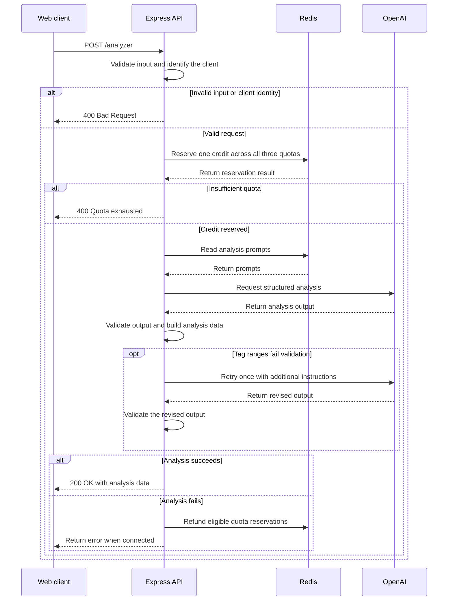

# 영어 구문 분석 / 편집기

[한국어](README.md) · [English](README.en.md) · [简体中文](README.zh-Hans.md) · [日本語](README.ja.md)


Syntax Analyzer는 영어 문장의 다양한 구문을 자동으로 분석해 주고, 원하는 형태로 구문을 편집할 수 있는 웹 어플리케이션입니다. 자주 사용하는 30여 가지의 문법 태그를 통해 복잡한 문장 구조를 한눈에 파악할 수 있도록 도와줍니다. 입력한 주제와 연관된 랜덤 문장 생성 기능도 제공합니다.

- 어플리케이션 링크: [https://syntax-analyzer.romantech.net](https://syntax-analyzer.romantech.net/)
- [Express API 명세](apps/api/README.md) · [로컬 개발 및 API 변경 가이드](docs/api-integration.md)
- 파인튜닝 레포지토리: [https://github.com/romantech/openai-fine-tuning](https://github.com/romantech/openai-fine-tuning)

# 목차

- [주요 기능](#주요-기능)
- [사용 스택](#사용-스택)
  - [Frontend](#frontend)
  - [Backend](#backend)
- [분석 데이터 생성 흐름](#분석-데이터-생성-흐름)
- [구문 분석기 동작 방식](#구문-분석기-동작-방식)
- [태깅 제약 조건](#태깅-제약-조건)
- [문장 성분 목록](#문장-성분-목록)
- [스크린샷](#스크린샷)

# 주요 기능

> [!NOTE]  
> `I'll`은 `I will`로 풀어서 분석합니다. 소유격이나 축약형이 될 수 있는 `'s`는 원문 그대로 분석합니다.\
> 숫자에 포함된 모든 쉼표(,)는 제거 후 분석합니다, e.g., `6,500` → `6500`

1. 영어 구문 분석: 주어, 동사, 목적어, 구/절 등 문장 성분 분석
2. 영어 구문 편집기: 30여 가지 문법 태그를 이용한 문장 구조 시각화
3. 영어 문장 생성: 입력한 주제와 연관된 랜덤 문장 생성

# 사용 스택

### Frontend

- **Framework**: React with TypeScript
- **UI Library**: Chakra UI
- **CSS Preprocessor**: SCSS
- **State Management**: Jotai / React Query
- **Form Handling**: React Hook Form / Yup
- **Animation**: Framer Motion / Lottie

### Backend

- **Framework**: Express with TypeScript
- **Database & Cache**: Redis (using ioredis)
- **Syntax Analysis**: OpenAI / LangChain

# 분석 데이터 생성 흐름

Express API는 요청을 검증한 뒤 Redis에서 분석 1회분을 예약합니다. OpenAI 분석 결과가 유효하면 분석 데이터를 반환하고, 분석에 실패하면 예약한 횟수를 복구합니다.



# 구문 분석기 동작 방식

먼저, 입력받은 문장의 토큰화 과정을 통해 각 단어를 최소 단위로 분리합니다. 이렇게 분리한 토큰들은 루트(최상위) 세그먼트에 포함시켜 그래프 구조로 관리합니다. 각 세그먼트는 시작과 끝에 대한 토큰 인덱스 정보를 가집니다. 문장 성분을 추가할 땐 토큰 인덱스 범위에 해당하는 세그먼트를 탐색하고, 필요에 따라 새로운 세그먼트를 생성하거나 결합합니다.

1. 시작-끝 범위가 현재 세그먼트 범위와 일치할 때: 해당 세그먼트에 추가
2. 시작-끝 범위가 현재 세그먼트 범위보다 작을 때: 자식 세그먼트 중 해당 범위를 포함하는 세그먼트 탐색
3. 시작-끝 범위를 포함하는 자식 세그먼트가 없을 때: 자식 세그먼트를 결합하여 새로운 세그먼트 생성
4. 자식 세그먼트가 하나도 없을 때: 새로운 세그먼트 생성

아래 이미지는 `Global warming is a significant issue` 문장을 기준으로 `3-6`, `5-6`, `4-6` 토큰 인덱스 범위에 문장 성분을 추가할 때마다 세그먼트가 어떻게 변화하는지 보여주는 예시입니다.


# 태깅 제약 조건

문장 성분 태깅은 문장의 각 단어나 구/절에 문법적인 역할을 표시하는 작업입니다. 태깅 작업은 기본적으로 단어 단위로 이루어지며, 구/절은 서로 교차할 수 없는 제약을 설정했습니다. 이미 구조가 형성된 세그먼트를 교차 태깅하면 기존 구조를 해체하고 재구성해야 하는 문제가 발생하기 때문입니다.

예를 들어 `Global warming is a significant issue` 문장에 아래처럼 `S`, `V`, `C`가 태깅된 상태에서 `warming is` 혹은 `is a significant` 구간을 태깅하는 것은 금지합니다. 대신 `Global warming is` 처럼 두 문장 성분을 모두 포함하는 구간은 허용합니다.

```
[Global warming] [is] [a significant issue]
---------------- ---- ---------------------
       S          V             C

허용 : Global warming is / is a significant issue
금지 : warming is / is a / is a significant
```

# 문장 성분 목록

[문장 성분 목록 보기](docs/syntax-tags.md)

# 스크린샷

#### 홈 화면


#### 영어 구문 분석 요청 양식


#### 영어 구문 편집기


#### 랜덤 문장 생성


