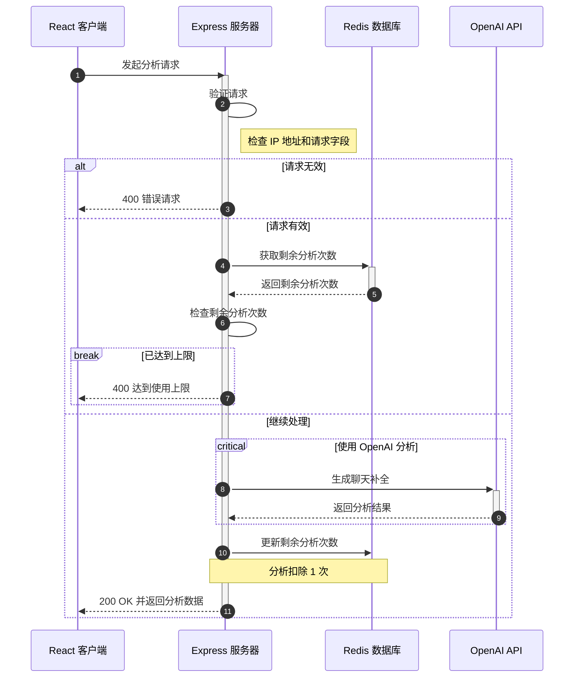

# 英语句法分析器与编辑器

[한국어](README.md) · [English](README.en.md) · [简体中文](README.zh-Hans.md) · [日本語](README.ja.md)


Syntax Analyzer 是一款可自动分析英语句子结构并编辑分析结果的网页应用。它使用 30 多种常用语法标签，让复杂的句子结构一目了然。它还可以根据你输入的主题随机生成英语句子。句法分析使用 GPT-6 Luna。

- 网页应用 · [https://syntax-analyzer.romantech.net](https://syntax-analyzer.romantech.net/)
- [Express API 文档](apps/api/README.md)
- 模型微调仓库 · [https://github.com/romantech/openai-fine-tuning](https://github.com/romantech/openai-fine-tuning)

# 目录

- [主要功能](#主要功能)
- [技术栈](#技术栈)
  - [前端](#前端)
  - [后端](#后端)
- [分析数据生成流程](#分析数据生成流程)
- [句法解析器的工作原理](#句法解析器的工作原理)
- [标签标注规则](#标签标注规则)
- [句子成分列表](#句子成分列表)
- [屏幕截图](#屏幕截图)

# 主要功能

> [!NOTE]
> 分析前会展开 `I'll` 等缩写形式，例如将 `I'll` 展开为 `I will`。既可表示所有格也可表示缩写的 `'s` 按原文分析。\
> 也会移除数字中的所有逗号，例如将 `6,500` 转为 `6500`。

1. 分析英语句子，识别主语、动词、宾语、短语和从句等成分。
2. 使用 30 多种语法标签直观呈现英语句子的结构，并编辑分析结果。
3. 根据输入的主题随机生成英语句子。

新版本部署后，如果应用提示页面无法加载，请点击 **刷新** 重新打开当前页面。

# 技术栈

### 前端

- **框架** · React + TypeScript
- **UI 库** · Chakra UI
- **CSS 预处理器** · SCSS
- **状态管理** · Jotai / React Query
- **表单处理** · React Hook Form / Yup
- **动画** · Framer Motion / Lottie

### 后端

- **框架** · Express + TypeScript
- **数据库与缓存** · Redis（使用 ioredis）
- **句法分析** · OpenAI / LangChain

# 分析数据生成流程



# 句法解析器的工作原理

解析器先对输入句子进行分词，将其拆成最小的词元。词元放入根层级的片段，各片段以图结构组织。每个片段记录起止词元的索引。添加句子成分时，解析器根据词元范围查找对应的片段，按需创建新片段或合并已有片段。

1. 如果范围与当前片段完全一致，将该成分添加到当前片段。
2. 如果范围小于当前片段，查找包含该范围的子片段。
3. 如果没有子片段包含该范围，合并子片段以创建新片段。
4. 如果没有任何子片段，直接创建新片段。

下图以 `Global warming is a significant issue` 为例，展示依次在词元索引范围 `3-6`、`5-6`、`4-6` 添加句子成分时，片段如何变化。


# 标签标注规则

AI 分析的概览显示主语、动词、宾语、补足语和状语等句法成分。动词所要求的地点标为处所补足语。展开详情可查看副词、介词短语等形式，也可查看完成体、进行体、被动语态和 do 助动词。 **展开所有标签**可查看全部标签，选择**折叠所有标签**可返回概览。添加或删除标签时会显示全部标签。标签默认以当前界面语言的完整名称显示。开启**缩写**开关即可显示缩写。刷新页面后会保留所选设置。

在移动设备上，轻点底部工具栏中的 **选择标签**。轻点起始单词，再轻点 **应用**，即可为该单词添加标签。要标注一段文字，请依次轻点起始和结束单词，再应用标签。轻点 **取消选择** 可清除选中的范围。句子较长时，可在句子上或标签下方的空白处左右滑动。标签堆叠高度超出屏幕时，可在同一区域上下滑动。内容超出显示区域时，垂直滚动条显示在标签区域右侧，水平滚动条显示在下方。删除模式下，轻点要删除的标签。

即使另一个浏览器标签页更改了列表顺序，标注仍会保存到开始编辑的那条句子。如果句子已被删除，编辑器会提示无法保存。

标注用于表示单词、短语或从句的语法作用。标注以完整单词为单位，短语和从句的范围不能交叉。如果新范围和已有范围交叉，就需要拆开并重建已有片段。

例如，`Global warming is a significant issue` 已如下所示标注了 `S`、`V`、`C`，因此无法为 `warming is` 或 `is a significant` 添加标签。像 `Global warming is` 这样完整包含两个句子成分的范围可以添加标签。

```
[Global warming] [is] [a significant issue]
---------------- ---- ---------------------
       S          V             C

允许: Global warming is / is a significant issue
禁止: warming is / is a / is a significant
```

# 句子成分列表

说明和表格请参见[句子成分列表](docs/syntax-tags.zh-Hans.md)文档。

# 屏幕截图

#### 首页


#### 英语句法分析表单


#### 英语句法编辑器


#### 随机句子生成器


